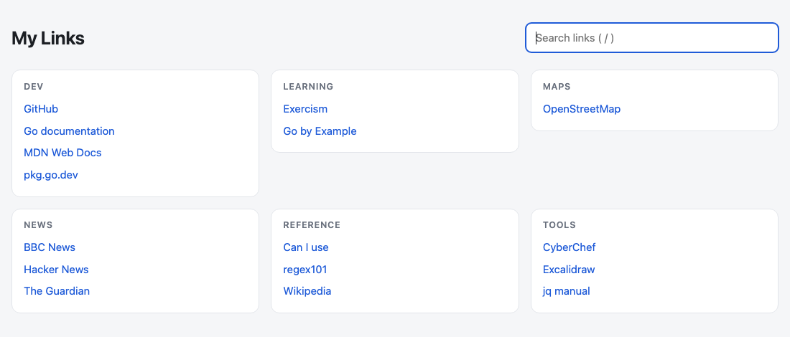

# linkdash

[](https://github.com/RonTom42/linkdash/actions/workflows/ci.yml)
[](https://github.com/RonTom42/linkdash/releases/latest)
[](LICENSE)

A small command-line tool that keeps your bookmarks in **one self-contained HTML page**: links grouped by category, sorted alphabetically, with instant search. No framework, no server, no database, no config file. The page *is* the data.

<picture>
  <source media="(prefers-color-scheme: dark)" srcset="docs/screenshot-dark.png">
  
</picture>

## Features

- **One file.** The generated page carries its own data. Open it locally, sync it with any file sync, or set it as your browser's start page.
- **Plain HTML, CSS and JavaScript.** No frameworks, no fonts or scripts from CDNs, no requests to anywhere. Links work even with JavaScript disabled.
- **Sorted for you.** Categories and the links within them are always alphabetical (case-insensitive).
- **Fast search on the page.** Type to filter, <kbd>Enter</kbd> opens the first match, <kbd>/</kbd> focuses the search box, <kbd>Esc</kbd> clears it. Light and dark mode follow your system.
- **Interactive when you want it.** `linkdash add` and `linkdash remove` without arguments open a searchable, fzf-style list in the terminal.
- **Safe by design.** Link names are escaped, `javascript:`/`data:` URLs are rejected, and linkdash refuses to overwrite HTML files it did not create.

## Install

With Go 1.27 or newer:

```sh
go install github.com/RonTom42/linkdash/cmd/linkdash@latest
```

Or download a prebuilt binary for macOS or Linux (amd64/arm64) from the [releases page](https://github.com/RonTom42/linkdash/releases/latest), for example:

```sh
curl -fsSL https://github.com/RonTom42/linkdash/releases/latest/download/linkdash_darwin_arm64.tar.gz | tar -xz linkdash
sudo mv linkdash /usr/local/bin/
```

## Quick start

```sh
export LINKDASH_FILE=~/links.html            # optional; defaults to ./linkdash.html

linkdash add -c Dev "Go documentation" go.dev/doc
linkdash add -c News "Hacker News" https://news.ycombinator.com
linkdash add                                 # interactive: pick a category, then type name and URL
open ~/links.html                            # or xdg-open on Linux
```

## Usage

```
linkdash [-f FILE] <command> [arguments]
```

| Command | What it does |
| --- | --- |
| `add [-c CATEGORY] [NAME URL]` | Adds a link. If the URL is already in that category, the link is renamed instead. In a terminal, anything you leave out is asked for: the category is chosen from a searchable list where you can also type a new one. |
| `remove [-c CATEGORY] [QUERY]` | Removes the link whose exact URL or name is `QUERY`. Without `QUERY`, or when it matches several links, a searchable list opens. Prints the `add` command that would undo the removal. |
| `list [-c CATEGORY]` | Prints all links, grouped by category. |
| `title TEXT` | Sets the page title. |
| `render` | Rewrites the page from the data stored in it, e.g. to pick up a new page design after upgrading linkdash. |
| `version` | Prints the version. |

Details:

- **Which file:** `-f FILE`, otherwise `$LINKDASH_FILE`, otherwise `./linkdash.html`. The file is created on the first `add`.
- **Flags can go anywhere:** `linkdash add "Go docs" go.dev -c Dev` works too.
- **URLs:** a missing scheme becomes `https://` (`go.dev` → `https://go.dev`). Any scheme except `javascript:`, `data:` and `vbscript:` is allowed, so `mailto:`, `file://` or `obsidian://` links work.
- **Categories** match case-insensitively and keep their first spelling. A category disappears with its last link.
- **Scripts:** when stdin is not a terminal, nothing is interactive: `add` needs `-c`, `NAME` and `URL`, and an ambiguous `remove` fails with a list of matches.

## How it works

Every page ends with a `<script type="application/json" id="linkdash-data">` block that holds all links. Each command reads that block, changes the data, and writes the whole page again, atomically, keeping the file's permissions and symlinks. Because the page is fully regenerated on every change, a newer linkdash version brings its page improvements to existing pages on the next change, or right away with `linkdash render`.

## Limitations

- The interactive list needs a Unix-like terminal (macOS, Linux, or WSL on Windows). Commands with all arguments given work anywhere Go runs.
- Sorting compares lower-cased text byte by byte, so names starting with accented letters (Ä, É, …) sort after Z.

## Contributing

Bug reports, ideas and pull requests are welcome. See [CONTRIBUTING.md](CONTRIBUTING.md) for the development setup, and [SECURITY.md](SECURITY.md) for reporting vulnerabilities privately.

## License

[MIT](LICENSE)
